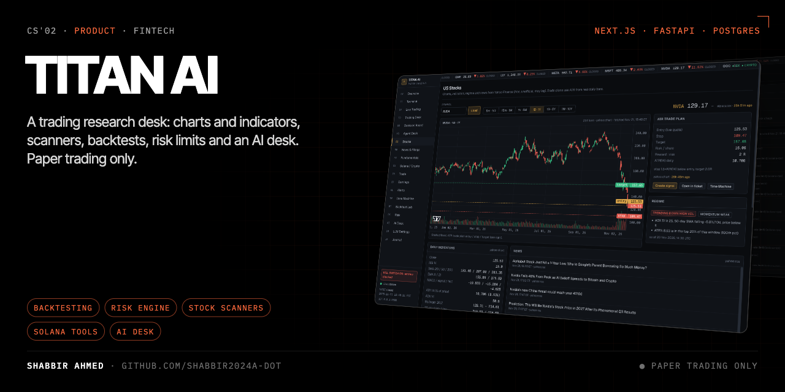
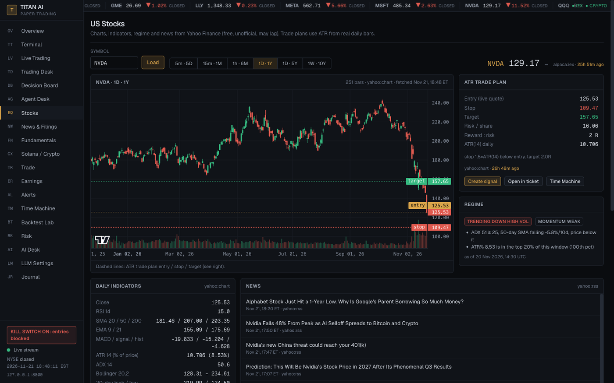
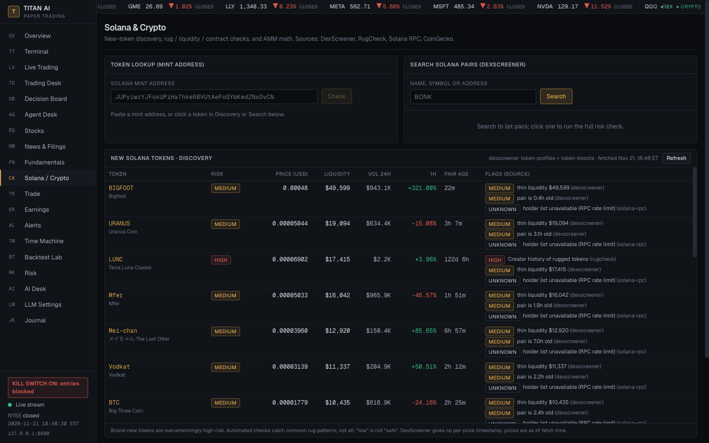
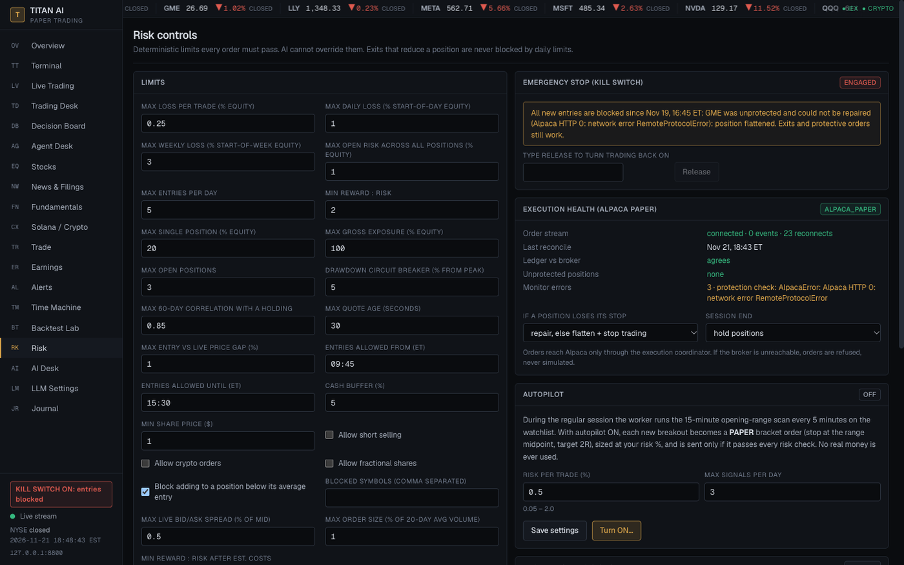

# TITAN AI

A trading research desk that runs on your own computer: live charts and indicators, stock and crypto scanners, backtests, hard risk limits and an AI desk that explains its reasoning. **It trades on paper accounts only.** No real money is ever at risk.

> TITAN AI is a research and paper-trading tool. It is not financial advice and does not trade real money.

## What it does

- US stocks: charts, indicators, market regime, news and ATR-based trade plans
- Daily and opening-range-breakout scanners across the US market
- Solana / crypto: new-token discovery, rug-risk reports, slippage and AMM calculators
- Backtest lab: fees and slippage included, walk-forward tests, cross-checks
- "Time machine": replays a trade thousands of times on real history
- Risk engine: per-trade, daily and weekly loss limits plus a kill switch
- AI desk (Claude / Grok) that explains signals; it cannot place orders by itself
- Decision journal: every signal, risk check and order is logged

## Screenshots

**US stocks with ATR trade plan**

**Solana token discovery and risk flags**

**Risk controls and kill switch**

## Built with

Next.js · TypeScript · Python (FastAPI) · PostgreSQL · WebSockets · Alpaca paper trading API

## Get the source code

The source code is **not in this repository**. It is sold as a one-time purchase that includes the full code, a setup guide and a licence to run it for your business or clients.

---

Made by [Shabbir Ahmed](https://github.com/shabbir2024a-dot) · Guwahati, India
